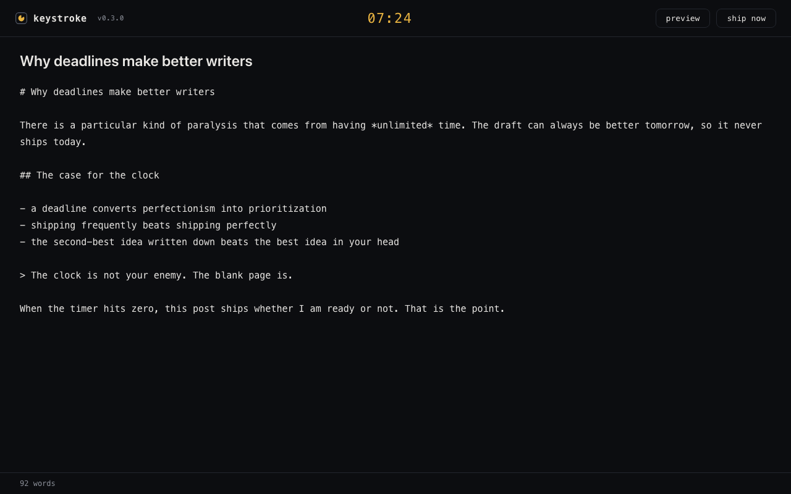
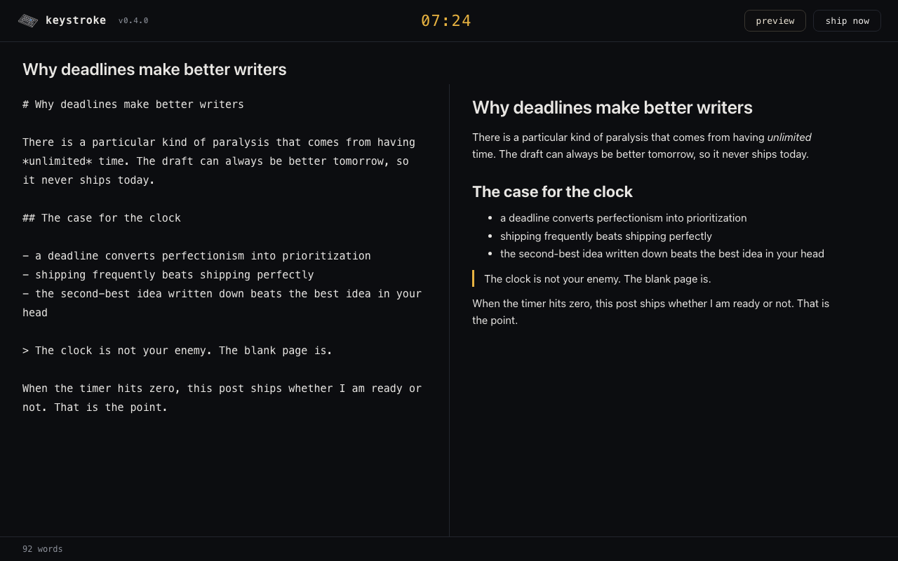
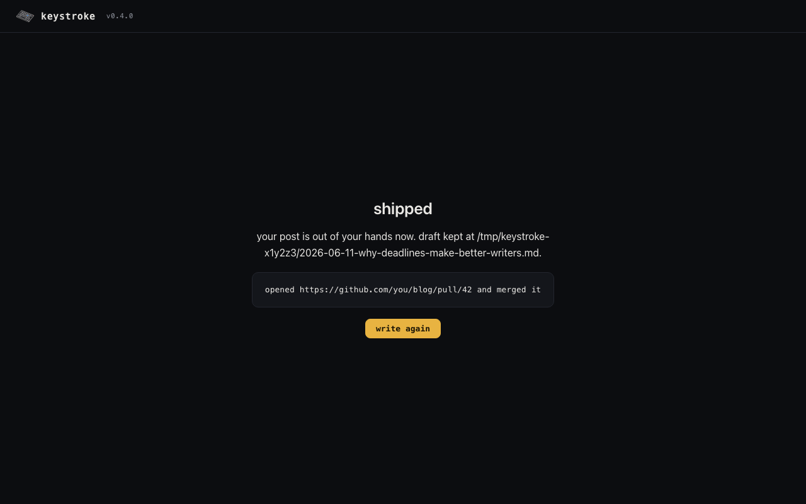

# keystroke

a markdown editor with an optional deadline. open it and write. when you
want pressure, start a timer: pick how long you have, and when the clock hits
zero your post ships through a hook you provide. no extensions.

## how it works

1. keystroke opens straight into a blank page with a live markdown preview
2. `save` (cmd+s) writes the post to `~/Documents/keystroke` as
   `YYYY-MM-DD-slug.md`; later saves update the same file. `new`
   (cmd+shift+n) saves and starts a blank page
3. `publish` runs your hook on the post right now
4. `timer` picks a duration (10, 15, 30, 45, or 60 minutes) and starts the
   clock on whatever you have so far. at zero, keystroke writes the post to a
   markdown file and runs your hook with it

the hook is only needed to publish or start a timer. a timer with nowhere to
ship to is just a draft, so keystroke shows setup instructions instead.

## examples







## install

requires node >= 20.

```sh
git clone https://github.com/iteratedcomputing/keystroke.git
cd keystroke
npm install
```

## run

just trying it out? start with the bundled word-count hook, which counts
your words and publishes nothing:

```sh
make demo
```

for real use, create a hook (any executable works). start from the
word-count example and overwrite it with your own publishing logic:

```sh
cp hooks/wordcount.sh hook
chmod +x hook
```

then start the app:

```sh
make dev
```

it opens http://localhost:7777 in your browser automatically. set
`KEYSTROKE_OPEN=0` to skip that.

your hook stays yours: `./hook` and `hooks/local/` are gitignored, so
personal hooks never end up in the repo. set `KEYSTROKE_HOOK` to use hooks
anywhere else, `KEYSTROKE_DRAFTS_DIR` to save somewhere other than
`~/Documents/keystroke`, and `PORT` to change the port.

## the hook

your hook receives the finished post as a markdown file path in `$1`, plus
`KEYSTROKE_TITLE`, `KEYSTROKE_SLUG`, and `KEYSTROKE_DURATION_MINUTES` in the
environment. exit 0 means published; anything else surfaces the failure in
the ui with your draft path so nothing is lost.

chain hooks by separating paths with colons. they run in order, and each
must exit 0 before the next starts:

```sh
export KEYSTROKE_HOOK=./hooks/front-matter.sh:./hooks/publish.sh
```

pass per-run values to your hooks with `--x-` flags instead of exporting env
vars. `--x-blog-tags=tech` becomes `KEYSTROKE_BLOG_TAGS=tech` in the hook
environment (uppercased, dashes to underscores). a bare flag like
`--x-blog-dry-run` is set to `1`:

```sh
node src/server.js --x-blog-tags=tech
make dev ARGS="--x-blog-tags=tech"
```

`make` treats `--`-prefixed words as its own options, so pass them through
the `ARGS` variable rather than `make dev --x-...`.

see [docs/hooks.md](docs/hooks.md) for the full contract and a
publish-to-blog example.

## development

```sh
make format   # prettier
make test     # node --test
make build    # no-op, nothing to compile
make dev      # run the server
make demo     # run the server with the bundled word-count hook
```
